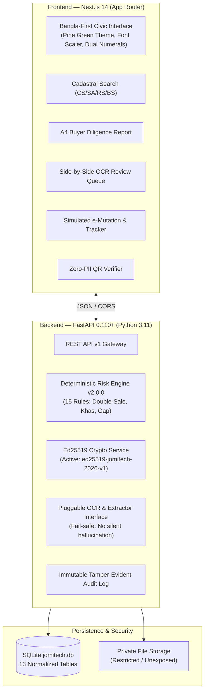

# JomiTech (জমিটেক) — Bangladesh Land-Record Verification & Risk-Intelligence System

<p align="center">
  <strong>ল্যান্ডটেক ২০২৬ (LandTech 2026) হ্যাকার্থন প্রোটোটাইপ</strong><br>
  <em>ভূমি রেকর্ড যাচাই, কৃত্রিম দ্বৈত-বিক্রয় শনাক্তকরণ ও ব্যাখ্যাযোগ্য ঝুঁকি গোয়েন্দা প্ল্যাটফর্ম</em>
</p>

<p align="center">
  
  
  
  
  
</p>

---

## 🏛️ Civic Notice & Ethical Truthfulness Policy

> **ডেমো ডেটা — সরকারি রেকর্ড নয় / Demo Data — Not an Official Government Record**  
> জমিটেক একটি প্রযুক্তিগত গবেষণা ও প্রদর্শনমূলক প্রোটোটাইপ। এই সিস্টেমের সমস্ত নাগরিক, দাগ, খতিয়ান, দলিল ও নামজারি কেস কাল্পনিক ও পরীক্ষামূলক সিন্থেটিক ডেটা। কোনো সরকারি সার্ভার স্ক্র্যাপ করা হয়নি বা লাইভ সরকারি সিস্টেমে অনুপ্রবেশের চেষ্টা করা হয়নি। জমিটেকের ঝুঁকি সূচক আদালতীয় স্বত্ব প্রত্যয়নপত্র বা প্রতারণার চূড়ান্ত আইনি প্রমাণ নয়; এটি নথিপত্রের অসঙ্গতি নির্দেশ করে যা একজন পেশাদার বা সহকারী কমিশনার (ভূমি) অফিসে যাচাইযোগ্য।

---

## 🎯 Problem Statement Focus

| Hackathon Module | Scope in JomiTech | Implementation Status |
|:---|:---|:---:|
| **P3 (Primary Focus)** | **Catch Fraud & Double-Selling** (সমাপতিত হস্তান্তর, বিক্রেতা অমিল, অতিরিক্ত হিস্যা বিক্রয়) | ✅ 15 Deterministic Rules (v2.0.0) |
| **P1 (Supporting)** | **Digitize Old Records** (দলিল আপলোড, হ্যাশ ইনডেক্সিং, মানব-পর্যালোচিত ওসিআর কিউ) | ✅ Pluggable OCR + Review Queue |
| **P2 (Supporting)** | **Verify Deeds & Ownership Evidence** (এড২৫৫১৯ স্বাক্ষর, বাইট-লেভেল প্রমাণ, জিরো-পিআইআই কিউআর) | ✅ RFC 8032 Ed25519 + SHA-256 |
| **P4 (Supporting)** | **Smart e-Mutation & Registry** (বিধিবদ্ধ চেকলিস্ট, শুনানির নোট ও রাজ্যযন্ত্র ট্রানজিশন) | ✅ Multi-stage Mutation State Machine |
| **P5 (Supporting)** | **Check Before You Buy** (ক্রেতার সার্বিক স্বত্বধারাবাহিকতা অডিট ও এ৪ প্রিন্টযোগ্য প্রতিবেদন) | ✅ Printable Due Diligence A4 Report |

---

## 🏗️ System Architecture



---

## 🌟 Key Innovations & Competitive Differentiation

1. **Original Civic Design & Branding (No Clones):**
   - Custom original vector cadastral logo (`CadastralLogo`).
   - High-trust forest pine palette (`#1b4d3e`), mint accents, and warm neutral background.
   - Global persistent font scaler (`Small`, `Default`, `Large`, `Extra Large`) and numerals mode switcher (`১২৩৪৫` ↔ `12345`).
   - Zero flashy marketing slop, zero generic AI placeholders.

2. **Explainable Deterministic Risk Engine (No Black-Box Probabilities):**
   - Risk score is a normalized discrepancy accumulator, not a black-box percentage.
   - Transparent *"কেন এই সতর্কতা?" (Why This Alert?)* accordion provides concrete registered deed IDs, plot numbers, and discrepancy dates.
   - Benign partial co-ownership transfers (Scenario 12) never trigger false-positive double-sale alerts.

3. **Strict Zero-PII Public Verification:**
   - Both `/public/verify/{opaque_id}` and `/public/mutation-track/{opaque_ref}` omit citizen names, national IDs, and raw uploaded scans.
   - Public QR codes embed random opaque references, impossible to harvest for private citizen data.

4. **Human-in-the-Loop OCR Review Queue:**
   - Low-confidence fields (<85%) require explicit human reviewer validation before indexing into the synthetic archive.
   - If OCR binaries are unavailable, the system transparently reports the engine status rather than inventing fake results.

---

## 🧪 12 Deterministic Synthetic Test Scenarios

The system comes pre-seeded with 12 deterministic cadastral scenarios covering the entire spectrum of land transactions:

1. **`PCL-DH-101`**: Clean unbroken chain of title (CS → SA → RS → BS) — `LOW RISK`.
2. **`PCL-DH-102`**: **Double-Sale Detected!** Same plot transferred to two separate buyers (`DEED-2024-1842` & `DEED-2024-9045`) — `HIGH RISK`.
3. **`PCL-DH-103`**: Seller mismatch between current registered holder and conveying party — `HIGH RISK`.
4. **`PCL-DH-104`**: Duplicate deed registration reference with matching byte hashes — `HIGH RISK`.
5. **`PCL-DH-105`**: Transfer exceeds seller's entitled recorded share — `HIGH RISK`.
6. **`PCL-DH-106`**: Deed registered over 180 days ago with no mutation petition — `MEDIUM RISK`.
7. **`PCL-DH-107`**: Mutation applicant identity differs from deed beneficiary — `MEDIUM RISK`.
8. **`PCL-DH-108`**: Chronological impossibility (future execution date) — `HIGH RISK`.
9. **`PCL-DH-109`**: Active government khas or vested property acquisition schedule — `HIGH RISK`.
10. **`PCL-DH-110`**: Missing predecessor link in historical survey progression (Survey Gap) — `MEDIUM RISK`.
11. **`PCL-DH-111`**: Unreviewed low-confidence OCR extraction job requiring human approval — `MEDIUM RISK`.
12. **`PCL-DH-112`**: Valid partial co-ownership transfer across three heirs — `LOW RISK` (Zero false positives).

---

## 🚀 Quickstart & Local Setup

### Prerequisites
- Linux / macOS / WSL2
- Python 3.11+
- Node.js 18+ and npm

### 1. Backend Setup
```bash
# Navigate to repository root
cd /home/xihad/hackathon

# Activate virtual environment
source backend/venv/bin/activate

# Run database seed (generates all 12 scenarios)
python backend/database/seed/seed_data.py

# Run all 30 automated backend tests
PYTHONPATH=. pytest backend/tests/ -v

# Start FastAPI backend server
PYTHONPATH=. uvicorn backend.app.main:app --host 127.0.0.1 --port 8000 --reload
```
API Documentation will be live at: `http://127.0.0.1:8000/docs`

### 2. Frontend Setup
```bash
# In a separate terminal
cd /home/xihad/hackathon/frontend

# Install dependencies (if needed)
npm install

# Run production build check
npm run build

# Start Next.js development server
npm run dev
```
Open your browser at: `http://localhost:3000/bn` (Bangla-first) or `http://localhost:3000/en` (English)

---

## 👥 Demo Personas & Fast Role Switcher

In development/evaluation mode, use the floating or header role-switcher:

| Persona Name | Role Code | Credentials | Primary Responsibilities |
|:---|:---|:---|:---|
| **মোঃ তারেক হাসান** | `citizen` | `citizen@jomitech.demo` / `demo123` | Parcel search, due diligence report, QR verification |
| **ফারজানা আক্তার** | `data_entry` | `dataentry@jomitech.demo` / `demo123` | Scanned deed ingestion, OCR preprocessing |
| **শফিকুল ইসলাম** | `reviewer` | `reviewer@jomitech.demo` / `demo123` | Side-by-side OCR review, field correction & approval |
| **নাজমুল হক** | `officer` | `officer@jomitech.demo` / `demo123` | Simulated e-mutation orders, statutory checklist |
| **সিস্টেম প্রশাসক** | `admin` | `admin@jomitech.demo` / `demo123` | RBAC matrix, rule configuration, audit logs |

---

## 📚 Technical Documentation

- **[Architecture Decision Records (ADRs)](file:///home/xihad/hackathon/docs/decisions.md):** Architectural decisions 001 through 010.
- **[Data Dictionary & Schema](file:///home/xihad/hackathon/docs/data_dictionary.md):** Complete table definitions, foreign keys, and risk definitions.
- **[Security & STRIDE Threat Model](file:///home/xihad/hackathon/docs/security_threat_model.md):** Cryptographic specification, Ed25519 lifecycle, and zero-PII privacy design.
- **[3-Minute Demo Script](file:///home/xihad/hackathon/docs/demo_script.md):** Step-by-step judge presentation guide with exact click paths.

---

## ⚖️ License & Hackathon Attribution

Developed for **LandTech 2026 Hackathon**. Built with original components, original cadastral vectors, and synthetic data. Zero live government systems or citizen PII utilized.
