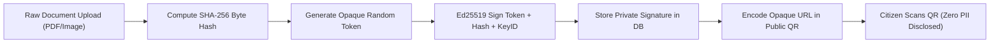

# JomiTech (জমিটেক) — Security Architecture & Threat Model

> **LandTech 2026 Security Standard**  
> Document Version: 2.0.0  
> Target System: Bangladesh Land Record Verification & Risk Intelligence Prototype  

---

## 1. Executive Summary & Civic Trust Principles

JomiTech is designed for high-trust civic interaction in Bangladesh land administration. Because real-world land disputes in Bangladesh often stem from forged documents, unauthorized double-selling, and unverified registry copies, JomiTech rejects speculative buzzwords (like hype blockchains) in favor of proven, battle-tested cryptographic primitives, strict privacy isolation, and explainable deterministic verification.

### Core Non-Negotiables:
1. **Zero-PII Public Endpoints:** Public QR scans and public mutation lookups reveal zero names, national IDs (NIDs), phone numbers, or private internal notes.
2. **Byte-Exact Integrity:** Document verification relies on server-computed SHA-256 hashes of exact bytes.
3. **Asymmetric Provenance:** Receipts are signed with Ed25519 (`ed25519-jomitech-2026-v1`). Private keys never leave server memory; public keys are published for universal verifiability.
4. **Append-Only Tamper-Evident Audit Trail:** Every status transition, approval, or rejection generates an immutable audit entry with actor attribution.
5. **Civic Honesty:** Clear persistent labelling that synthetic demo data does not constitute legal title certification or court-admissible title adjudication.

---

## 2. STRIDE Threat Model & Mitigations

| Threat Category (STRIDE) | Attack Vector / Scenario | JomiTech Countermeasure & Mitigation |
|:---|:---|:---|
| **Spoofing (পরিচয় জালিয়াতি)** | Malicious actor fabricates an AC Land mutation approval or creates forged deeds. | Ed25519 digital signature on all issued receipts. Any forged payload fails signature verification (`400 Bad Signature`). |
| **Tampering (নথি পরিবর্তন)** | Actor alters a deed scan by modifying boundaries or changing seller names. | SHA-256 byte-level hash comparison. A single altered pixel or character produces a completely different digest (`TAMPERED` status). |
| **Repudiation (দায় অস্বীকার)** | Land officer denies approving a questionable transfer or rejecting an applicant. | Immutable `audit_logs` table records actor ID, role, IP address, timestamp, and transition rationale. |
| **Information Disclosure (তথ্য ফাঁস)** | Harvester scrapes public QR codes to collect landowner NIDs and asset values. | Public endpoints (`/public/verify/{opaque_id}` and `/public/mutation-track/{opaque_ref}`) strictly omit citizen names, NIDs, and raw documents. |
| **Denial of Service (সেবা বিঘ্ন)** | Attacker uploads multi-gigabyte files or loops OCR processing to exhaust server CPU. | Server enforces 10MB file limit, content MIME validation (PDF, PNG, JPEG), and asynchronous background extraction queue. |
| **Elevation of Privilege (ক্ষমতার অপব্যবহার)** | Citizen account attempts to approve OCR jobs or mutate parcel ownership. | RBAC role checks on all officer/reviewer/admin endpoints. Default-deny policy enforced on unauthorized roles. |

---

## 3. Cryptographic Specification & Key Lifecycle



### Cryptographic Algorithms:
- **Hash Function:** SHA-256 (FIPS 180-4) calculated server-side over unaltered multipart stream.
- **Digital Signatures:** Ed25519 (RFC 8032 - Edwards-curve Digital Signature Algorithm over Curve25519).
- **Password Hashing:** Argon2id (RFC 9106) with memory cost 65536, time cost 3, parallelism 4.
- **Active Key ID:** `ed25519-jomitech-2026-v1`
- **Key Rotation Policy:** New key generation publishes a new `key_id`; historical receipts retain validation through archived public key ring.

---

## 4. Privacy & Data Minimization Protocol

When a citizen or third-party scans a JomiTech verification QR code, the mobile scanner receives a public verification URL:
`https://jomitech.land/verify/rcpt-synth-001`

### What is Exposed Publicly:
- Cryptographic status: `VALID`, `TAMPERED`, `REVOKED`, `EXPIRED`, or `UNKNOWN`
- Signature validation: `signature_valid: true/false`
- Hash match indicator: `sha256_match: true/false`
- Issuing authority key ID: `ed25519-jomitech-2026-v1`
- Synthetic reference: `REP-PCL-DH-101-2026`
- Civic disclaimer explaining legal limitations

### What is NEVER Exposed Publicly:
- Citizen legal names or family members
- National ID (NID) numbers or biometric identifiers
- Phone numbers or personal residential addresses
- Transaction monetary consideration amounts
- Raw deed scans or full un-redacted khatian registers

---

## 5. Audit Logging Architecture

All state mutations in JomiTech generate an un-editable audit record:
```json
{
  "id": "AUD-001C6867",
  "actor_id": "usr_officer_01",
  "actor_name": "Nazmul Haque",
  "actor_role": "officer",
  "action": "MUTATION_TRANSITION_OFFICER_REVIEW_TO_APPROVED",
  "entity_type": "MutationCase",
  "entity_id": "MUT-2024-9912",
  "request_ip": "127.0.0.1",
  "metadata_json": {
    "reason": "Statutory checklist verified; field report affirmative.",
    "from": "OFFICER_REVIEW",
    "to": "APPROVED"
  },
  "created_at": "2026-10-18T22:38:00Z"
}
```
**Safety Guarantee:** `metadata_json` sanitizes and filters out any session tokens, bearer authorization headers, private signing keys, or raw uploaded file bytes.
